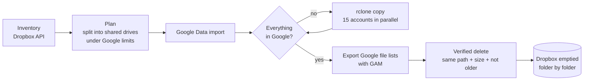

# Dropbox Business → Google Workspace migration (~118 TB)

Scripts and notes from a real migration I ran as the IT admin: moving a ~118 TB Dropbox Business
team (team folders and member folders, millions of files) into Google Workspace shared drives,
then removing from Dropbox **only** what was proven to be in Google.

> Client names, people, email addresses and Drive/Dropbox IDs are replaced with placeholders
> (`example.com`, `Big Team Folder`, `0AEXAMPLEDRIVE01`, …). The scripts are shown as they were
> used on the job, not packaged as a general-purpose tool.

## Results

| | |
|---|---|
| Data in scope (team folders) | ~42.5 TB, 1.5M+ files in the largest folder alone |
| Moved with Google's built-in Data import | 1.3M+ files, split across 6 shared drives to stay under Google's 500k-item limit |
| Moved with rclone (what the import couldn't reach) | ~157k files / 16.1 TB, 15 accounts in parallel, up to ~6.8 TB/day |
| Deleted from Dropbox after verification | ~1.66M files (~40 TB), **0 errors**, 0 files lost |

## The tools, in plain English

| Tool | What it is |
|---|---|
| **Google Data import** | Google's built-in migration tool in the Workspace Admin console. You give it a list of Dropbox folders and where each should go in Google, and it copies them in the background. |
| **[rclone](https://rclone.org)** | A free, open-source program for copying files between cloud services (Dropbox, Google Drive, OneDrive, Amazon S3 and dozens more). Think "copy and paste between clouds" that can run for days, skips files already copied, and retries on errors. |
| **[GAM](https://github.com/GAM-team/GAM)** | A free command-line tool for Google Workspace admins. It does what the Admin console does, but from scripts. Here it listed every file in every shared drive and created the drives. |
| **Dropbox API** | Dropbox's official way for programs to talk to it. The Python scripts use it to list files and to delete only the ones confirmed in Google. |
| **Service account** | A "robot" Google account that an admin has approved to act for users, so scripts run without anyone's password. Google limits each account to about 750 GB of uploads per day, so the copy used the service account to act as 15 separate accounts at once, raising the daily limit from 750 GB to about 11 TB. |
| **Jump box** | A separate, always-on computer used only to run long jobs like the copy. |

## How it worked

1. **Inventory** every team folder and member folder through the Dropbox API (file counts, sizes, who last modified what).
2. **Plan** how to split the data across shared drives so no drive goes past 400k items (Google's hard limit is 500k).
3. **Import** with Google's built-in Dropbox import, always as *delta* runs on one job so nothing is duplicated.
4. **Copy the leftovers with rclone.** The import silently skipped files inside nested shared folders and files last modified by people outside the company. rclone doesn't have those limits, so ~16 TB went across that way, split into 354 jobs over 15 temporary accounts.
5. **Verify, then delete.** Fresh exports of every shared drive are matched file by file against Dropbox. Only exact matches are deleted, and each folder is re-checked live right before its delete.

## Folder layout

| Folder | What's in it |
|---|---|
| [`scripts/python/`](scripts/python) | The main logic: inventory, planning and the verified delete. Runs on any computer with Python 3 |
| [`scripts/mac/`](scripts/mac) | The parallel copy runner and helper scripts for macOS (Bash) |
| [`scripts/windows-server/`](scripts/windows-server) | The same copy runner in PowerShell for an always-on Windows jump box or server |
| [`docs/`](docs) | Deeper reading: design, the safe-delete rules, lessons learned, and the commands in order |
| [`config/`](config) | A template for the Dropbox credentials file (fake values; the real one never goes in the repo) |

## Scripts by phase

| Phase | Script | What it does |
|---|---|---|
| Inventory | [`dropbox_inventory.py`](scripts/python/dropbox_inventory.py) | Lists every team folder; also the shared Dropbox connection code (token refresh, retries, paging) the other scripts use |
| | [`remaining_inventory.py`](scripts/python/remaining_inventory.py) | Lists member folders and the shared folders inside them; picks up where it left off if stopped |
| | [`storage_breakdown.py`](scripts/python/storage_breakdown.py) | Shows where the storage actually sits (team vs member vs shared) |
| Planning | [`plan_import_split.py`](scripts/python/plan_import_split.py) | Splits a 1.5M-file folder across new shared drives within Google's limits and writes the import CSVs |
| | [`make_shared_drives.sh`](scripts/mac/make_shared_drives.sh) | Creates the destination shared drives with GAM and adds the managers |
| | [`plan_rclone_jobs.py`](scripts/python/plan_rclone_jobs.py) | Matches every leftover file to its existing folder in Google and splits the work into ~1 TB per account |
| Copy | [`precreate_folders.sh`](scripts/mac/precreate_folders.sh) | Creates ~23k missing folders once, so parallel accounts never create duplicate folders |
| | [`run_parallel_copy.sh`](scripts/mac/run_parallel_copy.sh) | Runs 15 accounts in parallel with staggered starts: `start` / `status` / `stop` / `dry` |
| | [`windows-server/`](scripts/windows-server) | The same runner in PowerShell |
| | [`retry_missing_files.sh`](scripts/mac/retry_missing_files.sh) | Copies stragglers one at a time by exact path |
| | [`progress_check.sh`](scripts/mac/progress_check.sh) | Counts what arrived in Google since a given time |
| Verify & delete | [`delete_confirmed.py`](scripts/python/delete_confirmed.py) | The verified delete: `plan` (dry run), then `delete` (typed confirmation, live re-check, batches of 250) |
| | [`delete_confirmed_members.py`](scripts/python/delete_confirmed_members.py) | Same idea for each person's folder, checked against their My Drive |
| | [`find_drive_duplicates.py`](scripts/python/find_drive_duplicates.py) | Finds duplicate files across shared drives |
| Utilities | [`reauth_dropbox.py`](scripts/python/reauth_dropbox.py) | Re-connects the Dropbox app when permissions change, without ever printing a password or token |
| | [`move_out_of_shared.py`](scripts/python/move_out_of_shared.py) | An attempted workaround that Dropbox blocked (kept to show the troubleshooting) |
| | [`remove_empty_members.py`](scripts/python/remove_empty_members.py) | Removes empty, suspended Dropbox accounts after re-checking each one |

## Key decisions

- **Nothing is deleted on trust.** Every delete is backed by a fresh export of Google and re-checked against live Dropbox right before it happens. Anything uncertain stays.
- **Dry run first, typed confirmation second.** Every script that deletes or moves anything has a read-only mode and asks for a typed word (`DELETE`, `MOVE`, `REMOVE`) before acting.
- **Long copies need a dedicated machine.** Running rclone on my work laptop stopped the copy every time I closed the lid to move around the office or go home. Moving it to an always-on jump box (sleep turned off, plugged in, wired internet) is what kept it running day and night. Because the copy skips files already in Google, restarting after any interruption picked up exactly where it stopped. More in [Lessons learned](docs/LESSONS_LEARNED.md).
- **Passwords and keys never touch the code.** The Dropbox credentials load from a locked-down file outside the repo; Google access uses a service account.

## More detail

- [Lessons learned](docs/LESSONS_LEARNED.md): every problem that came up, why, and the fix.
- [Verified delete](docs/VERIFIED_DELETE.md): how "safe to delete" was defined and enforced.
- [Architecture](docs/ARCHITECTURE.md): the phases and the Google and Dropbox limits that shaped them.
- [Runbook](docs/RUNBOOK.md): the commands in the order they were run.

## Built with

Python 3 (standard library only) · Bash · PowerShell
