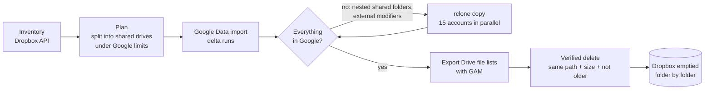

# Dropbox Business → Google Workspace migration (~118 TB)

Scripts and notes from a real migration I ran as the IT admin: moving a ~118 TB Dropbox Business
team (team folders and member folders, millions of files) into Google Workspace shared drives,
then removing from Dropbox **only** what was proven to be in Google.

> Client names, people, email addresses and Drive/Dropbox IDs are replaced with placeholders
> (`example.com`, `Big Team Folder`, `0AEXAMPLEDRIVE01`, …). The scripts are shown as they were
> used on the job, not packaged as a general-purpose tool.

## Results

| | |
|---|---|
| Data in scope (team folders) | ~42.5 TB, 1.5M+ files in the largest folder alone |
| Moved with Google's native Data import | 1.3M+ files planned into 6 shared drives under the 500k-item limit |
| Moved with rclone (what the import couldn't reach) | ~157k files / 16.1 TB, 15 accounts in parallel, ~6.8 TB/day at peak |
| Deleted from Dropbox after verification | ~1.66M files (~40 TB), **0 errors**, 0 files lost |
| Left behind on purpose | Paper docs and web-link shortcuts (can't be migrated), a handful of files changed after copying |

## How it worked

1. **Inventory** every team folder and member folder through the Dropbox API (file counts, sizes, who last modified what).
2. **Plan** how to split the data across shared drives so no drive passes 400k items (Google's hard limit is 500k) and each import run stays under its row and per-user caps.
3. **Import** with Google's built-in Dropbox import, always as *delta* runs on one job so nothing is duplicated.
4. **Copy the leftovers with rclone.** The import silently skipped content inside nested shared folders and files last modified by people outside the company. rclone doesn't care, so ~16 TB went across that way, split into 354 jobs over 15 temporary accounts.
5. **Verify, then delete.** Fresh GAM exports of every shared drive are matched file-by-file against Dropbox. Only exact matches are deleted, and each folder is re-checked live right before its delete.

## Repo map

| Phase | Script | What it does |
|---|---|---|
| Inventory | [`dropbox_inventory.py`](scripts/dropbox_inventory.py) | Read-only inventory of every team folder; also the shared Dropbox API module (auto token refresh, retries, paging) the other scripts import |
| | [`remaining_inventory.py`](scripts/remaining_inventory.py) | Resumable inventory of member folders and the shared folders mounted in them |
| | [`storage_breakdown.py`](scripts/storage_breakdown.py) | Where the storage actually sits (team vs member vs shared) |
| Planning | [`plan_import_split.py`](scripts/plan_import_split.py) | Splits a 1.5M-file folder into import rows across new shared drives (≤400k items per drive and per user, ≤150 rows per run, no prefix clashes) and writes the import CSVs |
| | [`make_shared_drives.sh`](scripts/make_shared_drives.sh) | Creates the destination shared drives with GAM and adds the managers |
| | [`plan_rclone_jobs.py`](scripts/plan_rclone_jobs.py) | Maps every leftover file to the deepest folder that already exists in Google, balances ~1 TB per account, and lists the folders to pre-create |
| rclone copy | [`precreate_folders.sh`](scripts/precreate_folders.sh) | Pre-creates ~23k folders once, so parallel accounts never race to create the same folder |
| | [`run_parallel_copy.sh`](scripts/run_parallel_copy.sh) | macOS runner: 15 accounts, staggered starts, retry logic, `start` / `status` / `stop` / `dry` |
| | [`windows/`](scripts/windows) | The same runner in PowerShell for a Windows jump box |
| | [`retry_missing_files.sh`](scripts/retry_missing_files.sh) | Copies stragglers one by one by exact path (fix for a case-sensitivity bug, see lessons) |
| | [`progress_check.sh`](scripts/progress_check.sh) | Counts what arrived in Google since a given time, per drive |
| Verify & delete | [`delete_confirmed.py`](scripts/delete_confirmed.py) | The verified delete for team folders: `plan` (dry run) → `delete` (typed confirmation, live re-check, batches of 250) |
| | [`delete_confirmed_members.py`](scripts/delete_confirmed_members.py) | Same idea for member folders matched against each person's My Drive |
| | [`find_drive_duplicates.py`](scripts/find_drive_duplicates.py) | Finds same-content files at the same path across shared drives |
| Utilities | [`reauth_dropbox.py`](scripts/reauth_dropbox.py) | Re-authorizes the Dropbox app when scopes change, without ever printing a token |
| | [`move_out_of_shared.py`](scripts/move_out_of_shared.py) | Attempted workaround: move content out of nested shared folders server-side (blocked by Dropbox quota, kept for reference) |
| | [`remove_empty_members.py`](scripts/remove_empty_members.py) | Removes empty, suspended Dropbox members after re-checking each one |

More detail:
- [docs/ARCHITECTURE.md](docs/ARCHITECTURE.md): the phases, the Google and Dropbox limits that shaped them, and the tools.
- [docs/VERIFIED_DELETE.md](docs/VERIFIED_DELETE.md): how "safe to delete" was defined and enforced.
- [docs/LESSONS_LEARNED.md](docs/LESSONS_LEARNED.md): the problems that came up and how each was solved.
- [docs/RUNBOOK.md](docs/RUNBOOK.md): the commands in the order they were run.

## Design choices worth pointing out

- **Nothing is deleted on trust.** Every delete is backed by a fresh export of Google and re-checked against live Dropbox right before it happens; anything uncertain stays.
- **Dry run first, typed confirmation second.** Every destructive script has a read-only `plan`/`dry` mode and asks for a typed word (`DELETE`, `MOVE`, `REMOVE`) before acting.
- **Resumable and re-runnable.** Inventories resume where they stopped; copies use `--ignore-existing`, so re-running after an outage only picks up what's missing.
- **Credentials never touch the code.** The Dropbox app credentials load from a `chmod 600` file outside the repo; Google access uses a service account with domain-wide delegation.
- **Standard library only.** The Python is stdlib-only (no pip installs), so it runs on any Mac with Python 3.

## Tech

Python 3 (stdlib) · Bash · PowerShell · Dropbox Business API · Google Drive API via [GAM7](https://github.com/GAM-team/GAM) · [rclone](https://rclone.org) · Google Workspace Data import

## Setup (if you want to read the code with context)

- `config/credentials.example.json` shows the shape of the Dropbox credentials file (`~/.config/dropbox_migration/credentials.json`, `chmod 600`).
- GAM7 configured with a service account; rclone with a `dropbox` remote and a Drive remote using the same service account (`impersonate=` per job).
