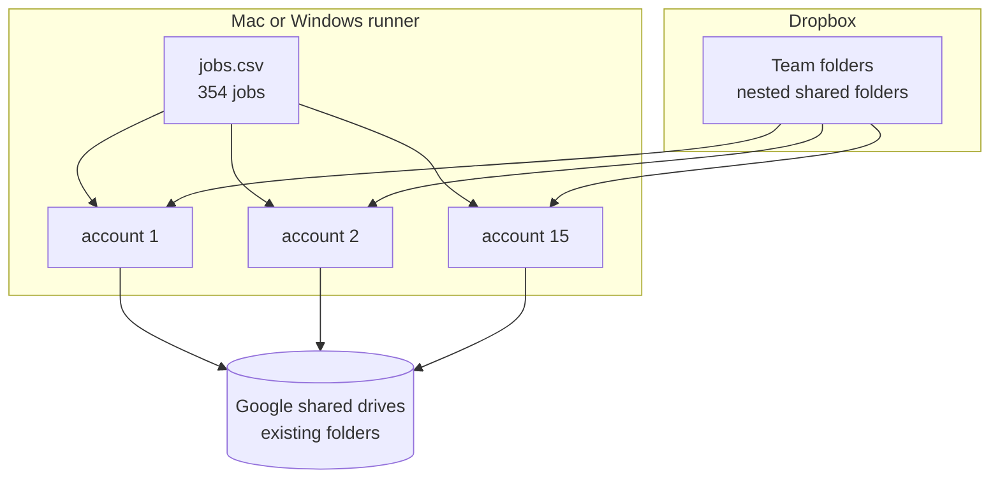

# Architecture

## The starting point

- Dropbox Business team, ~118 TB, 130+ licenses, far over its storage quota (so Dropbox blocked any server-side move that would add storage).
- ~48 team folders (~42.5 TB). One of them ("Big Team Folder") alone held 1.5M+ files.
- Member folders and internally shared folders made up the rest; those were a later phase.
- Target: Google Workspace (Business Plus) shared drives.

## Limits that shaped the design

| Limit | Value | Effect on the plan |
|---|---|---|
| Items per shared drive | 500,000 (files + folders + shortcuts + trash) | Fill each drive to ≤400k; the big folder was split across 6 new drives |
| Items per Target user per import run | 500,000 | Spread rows across 3 import users, ≤400k each |
| Rows per import CSV | 150 | Two import runs for the big folder |
| Rows can't be string prefixes of each other | `/X/2019` vs `/X/2019 Old` | Planner moves clashing rows to separate runs |
| Upload per account per day | ~750 GB | rclone spread over 15 temporary accounts |
| Dropbox API rate limits | "Too many requests… retry in 300 s" | Staggered starts, no per-file lookups (see lessons) |

## Phase 1: inventory (read-only)

`dropbox_inventory.py` walks every team folder through the Dropbox API as the team admin, using the
team-space root namespace. It counts files, sizes and nested shared folders. `remaining_inventory.py`
does the same for member folders and is resumable (it checkpoints, so a crash or a sleep loses nothing).

## Phase 2: Google's native Data import

- `plan_import_split.py` lists the big folder (resumable, ~1 hour) and picks split points up to 5 levels
  deep so every drive lands at ≤400k items. Folders that would need recreating get created with GAM first.
- The import runs as **delta runs on one job**. Starting a new job re-copies everything, so that was never done.
- Result: 1.3M+ files from the big folder imported over two multi-day runs.

## Phase 3: rclone for what the import couldn't reach

The import silently skipped ~157k files (16 TB). Two causes, both confirmed:
1. Content inside **nested shared folders** (a shared folder inside a team folder) was never discovered by the import's crawler.
2. Google skips any file **last modified by an account outside the organization**. 83% of the leftovers were last modified by removed members or outside collaborators.

rclone reads Dropbox as the team admin and doesn't care who last modified a file, so:
- `plan_rclone_jobs.py` maps each leftover file to the deepest folder that already exists in Google, using
  Google's exact folder-name casing, and splits the work into 354 jobs (~1 TB per account).
- `precreate_folders.sh` creates the ~23k missing folders once, from one account, before any copying,
  so parallel accounts never create duplicate twin folders.
- `scripts/mac/run_parallel_copy.sh` (macOS) and `scripts/windows-server/*.ps1` (Windows jump box or server) run 15 accounts in parallel, each working
  through its own job list with `--ignore-existing`, staggered 10 minutes apart.

## Phase 4: verify, then delete

See [VERIFIED_DELETE.md](VERIFIED_DELETE.md). In short: export every shared drive with GAM, match each
Dropbox file by path + size + modified time, and delete only exact matches, re-checking each folder
live first.

## Tools

- **Dropbox API** called directly from Python (`urllib`, stdlib only) with automatic token refresh and backoff.
- **GAM7** for Drive exports (`print filelist … fullpath`), shared drive creation and membership.
- **rclone** v1.76 for the copy, using a Google service account with `impersonate=` per job.
