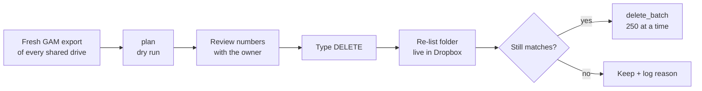

# Verified delete: only delete what's provably in Google

Deleting the source is the risky half of any migration. Every Dropbox delete in this project went
through `delete_confirmed.py` (team folders) or `delete_confirmed_members.py` (member folders).
Across six passes they removed ~1.66M files (~40 TB) with 0 errors.

## What "confirmed" means

A Dropbox file is deleted only when Google has a file that matches on **all** of:

1. **Same path** inside the same team folder (Drive paths come from a fresh GAM export; the team folder is
   located in each Drive path automatically, because different import runs nested it at different depths).
2. **Same size**, to the byte.
3. **Google copy not older** than the Dropbox version (±2 s). rclone sets Drive's modifiedTime to the
   Dropbox client time, so rclone copies pass this check naturally. One documented exception: files whose
   only newer Dropbox timestamp came from a known bulk-rename run count as unchanged.

Anything else stays, with the reason written to `kept_in_dropbox.csv` ("not in Google", "changed in
Dropbox after Google copied it", …).

## How it's enforced

- **`plan` first.** A read-only run writes `delete_plan.csv` and a summary: files and GB per team folder
  and which shared drive holds each confirmed copy. Nothing changes.
- **Typed confirmation.** `delete` asks for the word `DELETE` and shows the totals first.
- **Live re-check.** Right before deleting a folder's files, the script re-lists that folder in Dropbox and
  re-runs the match, so anything that changed since the plan stays.
- **Whole folders when possible.** If every file under a folder is confirmed, the folder is deleted as one
  operation (fewer API calls); otherwise files go individually.
- **Soft delete.** Dropbox `delete_batch` moves files to Dropbox's deleted files, so they stay restorable for
  the plan's retention window: a second safety net.
- **Full log.** Every file's result goes to `delete_results.csv`.

## Sanity checks used before each real pass

- Dry-run totals compared with what the copy said it moved (e.g. 49,752 confirmed vs 49,688 copied + 66 from a test).
- Per-drive "confirmed copies found in" counts compared with what each drive received.
- Never run a delete while an import is running, so reports stay clean.
